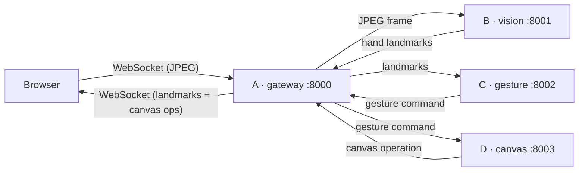

# hand-gesture-whiteboard

MediaPipe 기반 **실시간 손동작 원격 그림판**. Browser webcam으로 손을 인식하고, 손동작(gesture)으로 그림을 그리고, 지우고, 확대·축소한다.
4개의 Docker microservice로 구성되며, 팀원 한 명이 서비스 하나를 독립적으로 맡아 개발한다.

> **현재 상태: Repository scaffold.**
> 디렉터리 구조, Docker 개발 환경, Data contract(JSON Schema), 설계 문서만 있다.
> 애플리케이션 코드(FastAPI, MediaPipe, gesture, drawing)는 아직 **구현하지 않았다**. 각 container는 `sleep infinity`로 대기한다.

---

## 1. Architecture



Gateway가 유일한 orchestrator이며 (hub-and-spoke), 내부 서비스끼리는 서로 직접 호출하지 않는다.
상세: [docs/architecture.md](docs/architecture.md)

### Architecture rules

1. Camera image는 **Gateway → Vision까지만** 이동한다.
2. Vision 이후에는 **원본 이미지를 다른 container로 전달하지 않는다.**
3. Vision은 **landmark data만** 반환한다.
4. Gesture는 **landmark만** 입력받는다.
5. Canvas는 **gesture command만** 입력받는다.
6. Browser는 전달받은 landmark로 **hand skeleton을 client-side overlay**로 그린다.
7. 모든 container는 `trace_id` / `frame_id` (및 `session_id`)를 **변경 없이 보존**한다.

---

## 2. Container 책임

| Container | Port | 책임 |
|---|---|---|
| **A · gateway** | 8000 (host 노출) | Browser webcam frame 수신(WebSocket), Frontend 제공, 내부 서비스 호출 orchestration, skeleton overlay용 landmark 전달, `trace_id` 발급, end-to-end latency 측정 |
| **B · vision** | 8001 (internal) | MediaPipe Hand Landmarker. JPEG frame → hand landmarks (hand당 21개 normalized x/y/z, handedness, confidence), `vision_ms` |
| **C · gesture** | 8002 (internal) | landmark → gesture state machine → semantic command (`DRAW_*`, `ERASE_*`, `ZOOM_*`, `IDLE`, `UNDO`, `REDO`, `CLEAR`), `gesture_ms` |
| **D · canvas** | 8003 (internal) | gesture command → stroke state 관리, undo/redo/clear, canvas operation 생성, 최종 PNG export, `canvas_ms` |

## 3. 팀원 역할

| Container | 담당 디렉터리 | 담당자 | GitHub | 비고 |
|---|---|---|---|---|
| A · gateway | `services/gateway/` | | | Frontend 포함 |
| B · vision | `services/vision/` | | | |
| C · gesture | `services/gesture/` | | | |
| D · canvas | `services/canvas/` | | | |
| Contract / Docs | `shared/`, `docs/` | 공동 | | 변경 시 전원 리뷰 |

## 4. Container별 Input / Output

| Container | Input | Output | Contract |
|---|---|---|---|
| gateway | Browser WS binary (meta + JPEG) | Browser WS JSON (landmarks + canvas ops + timings) | [api-contract.md §3.1](docs/api-contract.md) |
| vision | FrameMessage + `image/jpeg` | LandmarkMessage | [`frame.schema.json`](shared/contracts/frame.schema.json) → [`landmark.schema.json`](shared/contracts/landmark.schema.json) |
| gesture | LandmarkMessage | GestureMessage | [`landmark.schema.json`](shared/contracts/landmark.schema.json) → [`gesture.schema.json`](shared/contracts/gesture.schema.json) |
| canvas | GestureMessage | CanvasMessage (+ PNG export) | [`gesture.schema.json`](shared/contracts/gesture.schema.json) → [`canvas.schema.json`](shared/contracts/canvas.schema.json) |

모든 message 공통 field: `schema_version`, `trace_id`, `session_id`, `frame_id`, `timestamp_ms`.
예시: [`shared/examples/`](shared/examples) · 상세: [docs/api-contract.md](docs/api-contract.md)

## 5. Repository 구조

```
hand-gesture-whiteboard/
├── README.md
├── compose.yaml
├── .env.example
├── docs/                 # architecture, api-contract, gesture-spec, benchmark-plan
├── shared/
│   ├── contracts/        # JSON Schema (draft 2020-12)
│   └── examples/         # schema를 통과하는 예시 message
└── services/
    ├── gateway/          # Dockerfile, requirements.txt, src/, tests/
    ├── vision/           # + models/ (hand_landmarker.task, git ignore)
    ├── gesture/
    └── canvas/
```

## 6. Docker 실행 방법

요구사항: Docker Desktop (Compose v2)

```bash
cp .env.example .env          # 선택: 포트/설정 변경 시
docker compose config         # compose 문법 검증
docker compose build          # 4개 image build
docker compose up -d          # 실행 (현재는 placeholder: sleep infinity)
docker compose ps             # gateway, vision, gesture, canvas 4개 running 확인
```

개발 시:

```bash
docker compose exec vision bash        # container 접속
docker compose logs -f gateway         # 로그
docker compose build vision            # requirements.txt 변경 후 재빌드
docker compose down                    # 종료
```

- 각 `services/<name>/` 디렉터리는 container의 `/app`에 bind mount 되므로 코드 수정이 즉시 반영된다.
- `shared/`는 모든 container의 `/shared`에 **read-only**로 mount 된다 (schema 검증용).
- Host에 노출되는 포트는 gateway `8000`뿐이다. 내부 서비스는 `hand-net` network에서 `http://vision:8001` 등으로 접근한다.
- 서비스 구현 후 `compose.yaml`의 `command: ["sleep", "infinity"]`를 `uvicorn ... --reload`로 교체한다.

## 7. 향후 구현 순서

1. **Contract 확정** — `shared/contracts/` 리뷰, 예시 message validation 테스트
2. **Health check** — 4개 서비스에 FastAPI `GET /healthz`, compose `command`를 uvicorn으로 교체
3. **Mock pipeline** — 각 서비스가 `shared/examples/`를 그대로 반환하는 stub으로 gateway end-to-end 연결 확인
4. **gateway** — WebSocket 수신, trace_id 발급, 순차 orchestration, latest-wins backpressure, 최소 Frontend (webcam + canvas)
5. **vision** — MediaPipe Hand Landmarker 연결, JPEG → landmarks
6. **Browser skeleton overlay** — landmark로 hand skeleton 그리기
7. **gesture** — MVP state machine (Draw / Eraser / Zoom / Idle)
8. **canvas** — stroke state, operation 생성
9. **Secondary** — Undo / Redo / Clear, PNG export
10. **Benchmark** — [docs/benchmark-plan.md](docs/benchmark-plan.md) 시나리오 측정 및 튜닝
11. **Stretch** — Color change / Brush size / Pan

## 8. MVP 기능

| 우선순위 | 기능 |
|---|---|
| **MVP** | Draw, Eraser, Zoom, Idle |
| Secondary | Undo, Redo, Clear |
| Stretch | Color change, Brush size, Pan |

상세: [docs/gesture-spec.md](docs/gesture-spec.md)

## 9. Benchmark 목표

| 지표 | 목표 (초안) |
|---|---|
| `e2e_ms` | p50 ≤ 100 ms, p95 ≤ 150 ms |
| `vision_ms` | p50 ≤ 30 ms (CPU) |
| `gesture_ms` / `canvas_ms` / `gateway_ms` | p95 ≤ 2 / 5 / 5 ms |
| `vision_fps` | ≥ 20 fps (input 30 fps) |
| `drop_rate` | ≤ 30 % |
| CPU / Memory | vision ≤ 200 % / 800 MiB, 나머지 각 ≤ 30 % / 200 MiB |
| payload size | frame ≤ 40 KB, result ≤ 8 KB |

측정 지표: `gateway_ms`, `vision_ms`, `gesture_ms`, `canvas_ms`, `e2e_ms`, `input_fps`, `vision_fps`, `drop_rate`, CPU usage, Memory usage, payload size.
모든 측정값은 `trace_id` / `frame_id`로 추적한다. 상세: [docs/benchmark-plan.md](docs/benchmark-plan.md)
