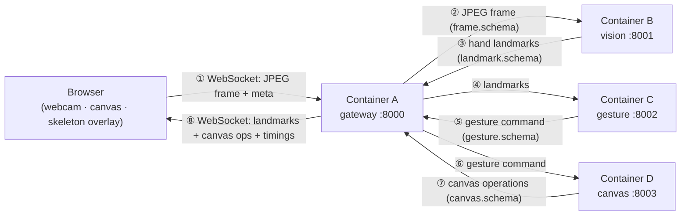
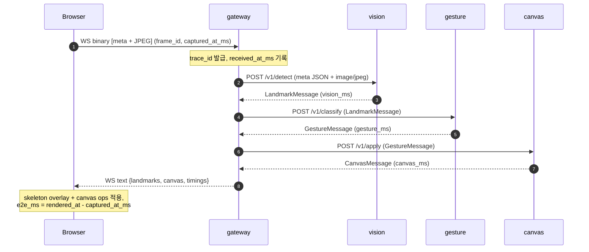
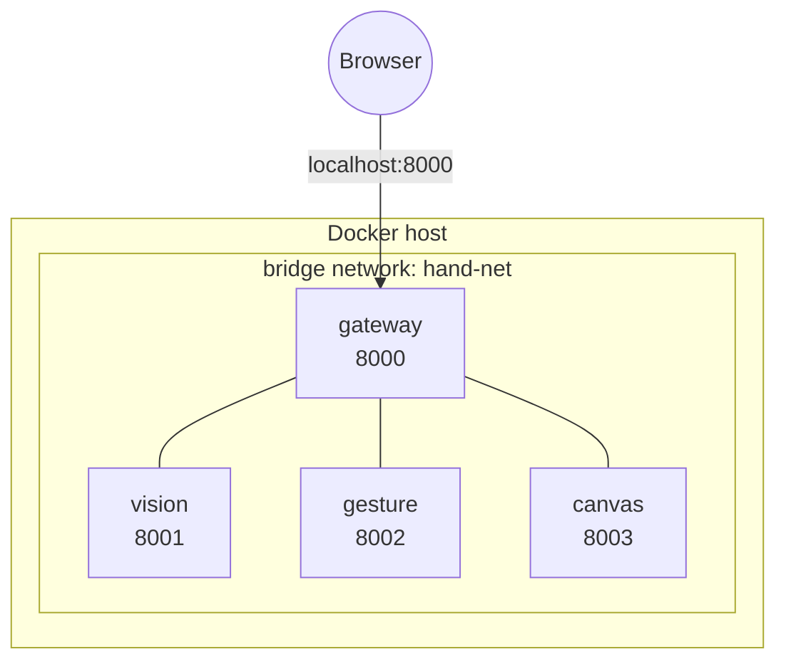

# Architecture

> 상태: **Scaffold**. 아래 내용은 구현 목표 설계이며, 아직 애플리케이션 코드는 없다.

## 1. 개요

Browser webcam frame을 Gateway가 받아 내부 서비스(Vision → Gesture → Canvas)를 순차 호출하고,
그 결과(landmark + canvas operation)를 다시 Browser로 돌려준다. Gateway는 **유일한 orchestrator**이며,
내부 서비스끼리는 서로를 직접 호출하지 않는다 (hub-and-spoke).

## 2. Data flow

## 3. Sequence (한 frame의 생애)

## 4. Container topology

- Host에 노출되는 포트는 **gateway 8000** 하나뿐이다. vision/gesture/canvas는 `expose`만 하며 `hand-net` 내부 DNS(`http://vision:8001` 등)로만 접근한다.
- 총 container 수는 4개로 고정한다. Redis/Kafka/RabbitMQ/DB/Prometheus/Grafana 등 추가 인프라는 사용하지 않는다.

## 5. Architecture rules

1. Camera image는 **Gateway → Vision 구간에서만** 이동한다.
2. Vision 이후에는 원본 이미지를 어떤 container로도 전달하지 않는다.
3. Vision은 **landmark data만** 반환한다.
4. Gesture는 **landmark만** 입력받는다.
5. Canvas는 **gesture command만** 입력받는다.
6. Hand skeleton은 Browser가 landmark를 받아 **client-side overlay**로 그린다 (서버에서 이미지에 그리지 않음).
7. 모든 container는 `trace_id` / `session_id` / `frame_id`를 **변경 없이 보존**하여 응답과 로그에 포함한다.

## 6. 상태(State) 소유권

| Service | Stateful? | 상태 내용 |
|---|---|---|
| gateway | session 단위 | WebSocket 연결, frame_id 카운터, in-flight frame, drop 카운트 |
| vision | stateless (모델만 로드) | MediaPipe Hand Landmarker 인스턴스 |
| gesture | session 단위 | gesture state machine (현재 상태, debounce 카운터, stroke_id) |
| canvas | session 단위 | stroke 목록, undo/redo stack, view transform, sequence |

Gesture와 Canvas는 session 상태를 메모리에 가지므로 **각 1개 replica**로 운영한다 (scale-out 시 session affinity 필요 — 현 범위 밖).

## 7. Backpressure / Frame drop 정책 (계획)

- Gateway는 session당 **in-flight frame 최대 1개**를 유지한다.
- 처리 중 새 frame이 도착하면 대기 중인 frame을 최신 것으로 **교체(latest-wins)** 하고, 버려진 frame은 `drop_rate` 집계에 포함한다.
- 이를 통해 vision이 input fps를 따라가지 못해도 latency가 누적되지 않도록 한다.
