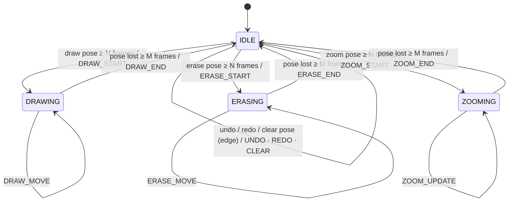

# Gesture Specification

> 상태: **Scaffold / Draft**. 손 모양 판정 기준(threshold)은 구현·실험 단계에서 확정한다.

## 1. 우선순위

| 단계 | 기능 | Gesture command | 비고 |
|---|---|---|---|
| **MVP** | Draw | `DRAW_START` / `DRAW_MOVE` / `DRAW_END` | 검지 pointer |
| **MVP** | Eraser | `ERASE_START` / `ERASE_MOVE` / `ERASE_END` | |
| **MVP** | Zoom | `ZOOM_START` / `ZOOM_UPDATE` / `ZOOM_END` | |
| **MVP** | Idle | `IDLE` | pointer 이동만 (그리지 않음) |
| Secondary | Undo | `UNDO` | 1회성 (edge-triggered) |
| Secondary | Redo | `REDO` | 1회성 |
| Secondary | Clear | `CLEAR` | 1회성, 오작동 방지를 위해 hold 시간 길게 |
| Stretch | Color change | `params.color` | |
| Stretch | Brush size | `params.brush_size` | |
| Stretch | Pan | (추가 예정: `PAN_*`) | schema MINOR 버전업 필요 |

## 2. 손 모양 후보 (초안)

Landmark id: 4 THUMB_TIP, 8 INDEX_TIP, 12 MIDDLE_TIP, 16 RING_TIP, 20 PINKY_TIP, 0 WRIST.

| Command 군 | 손 모양 (초안) | 판정 아이디어 |
|---|---|---|
| Draw | 검지만 편 상태 (☝) | index extended, 나머지 folded |
| Idle / Hover | 검지+중지 편 상태 (✌) 또는 손 펼침 | pointer만 이동 |
| Eraser | 주먹 또는 손바닥 전체 | 손바닥 중심을 eraser pointer로 |
| Zoom | 엄지–검지 pinch 거리 변화 (또는 양손 거리) | `zoom_scale = d / d_start` |
| Undo | 엄지 왼쪽 swipe / 특정 포즈 hold | edge-triggered |
| Redo | 엄지 오른쪽 swipe / 특정 포즈 hold | edge-triggered |
| Clear | 양손 펼침 hold (≥ 1.5 s) | 오작동 방지 |

## 3. State machine

### 규칙

1. **상호 배타**: DRAWING / ERASING / ZOOMING 중 동시에 하나만 활성.
2. **반드시 닫기**: `*_START`를 보냈다면 손이 사라지거나 다른 포즈로 바뀌어도 반드시 `*_END`를 먼저 보낸 뒤 다음 상태로 전이한다.
3. **Debounce**: 상태 진입은 `N`프레임 연속(초안 N=3), 이탈은 `M`프레임 연속(초안 M=3) 유지되어야 한다. 값은 `params.state_frames`로 디버깅.
4. **Edge-triggered command**(`UNDO`, `REDO`, `CLEAR`)는 포즈 유지 중 **1회만** 발행하고, 포즈가 해제될 때까지 재발행하지 않는다 (cooldown).
5. **손 없음**: `hands = []`이면 진행 중 상태는 `M`프레임 후 `*_END`, 이후 `IDLE` + `pointer = null`.
6. **다중 손**: MVP는 `confidence`가 가장 높은 손 1개만 사용 (`hand_index`로 명시). 양손 zoom/clear는 Secondary 이후.
7. **좌표 smoothing**: pointer에는 EMA 또는 One-Euro filter 적용 예정 (gesture 서비스 내부).
8. **Frame drop 내성**: gesture는 연속 frame_id를 가정하지 않는다. frame_id gap이 있어도 상태 머신은 정상 동작해야 한다.

## 4. Gesture → Canvas operation 매핑

| Gesture | Canvas operations |
|---|---|
| `IDLE` | `[]` (또는 `noop`) |
| `DRAW_START` | `stroke_begin` |
| `DRAW_MOVE` | `stroke_append` |
| `DRAW_END` | `stroke_end` (undo stack push) |
| `ERASE_START` / `MOVE` / `END` | `erase_begin` / `erase_append` / `erase_end` (지워진 stroke는 `remove_stroke`) |
| `ZOOM_START` / `UPDATE` / `END` | `set_view` |
| `UNDO` | `remove_stroke` 또는 `restore_stroke` (마지막 action 역연산) |
| `REDO` | undo의 역연산 |
| `CLEAR` | `clear` (undo 가능하도록 history에 기록) |
